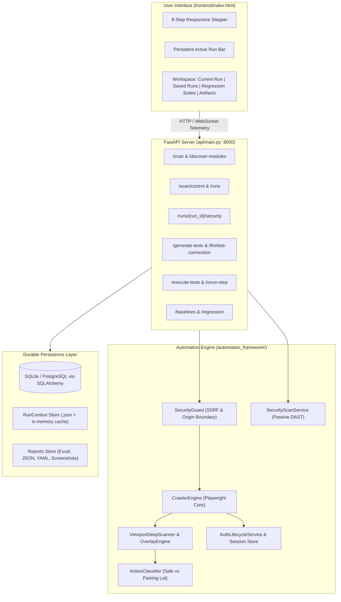
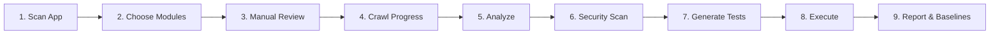
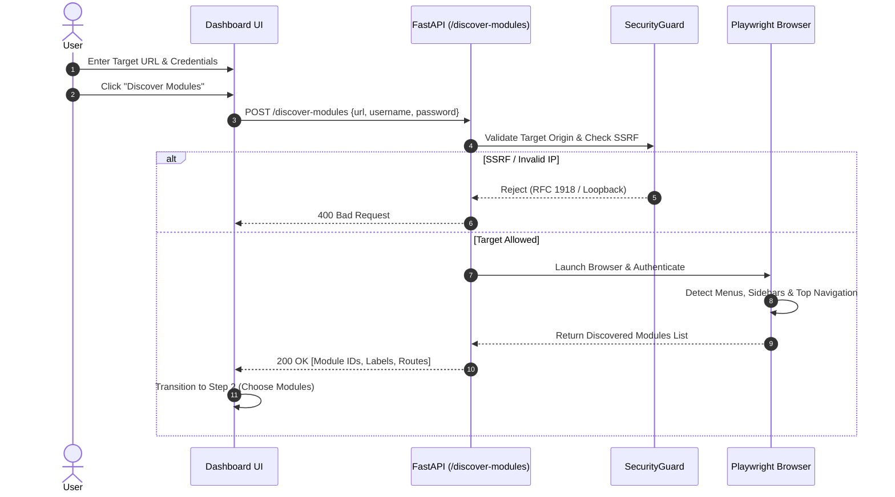
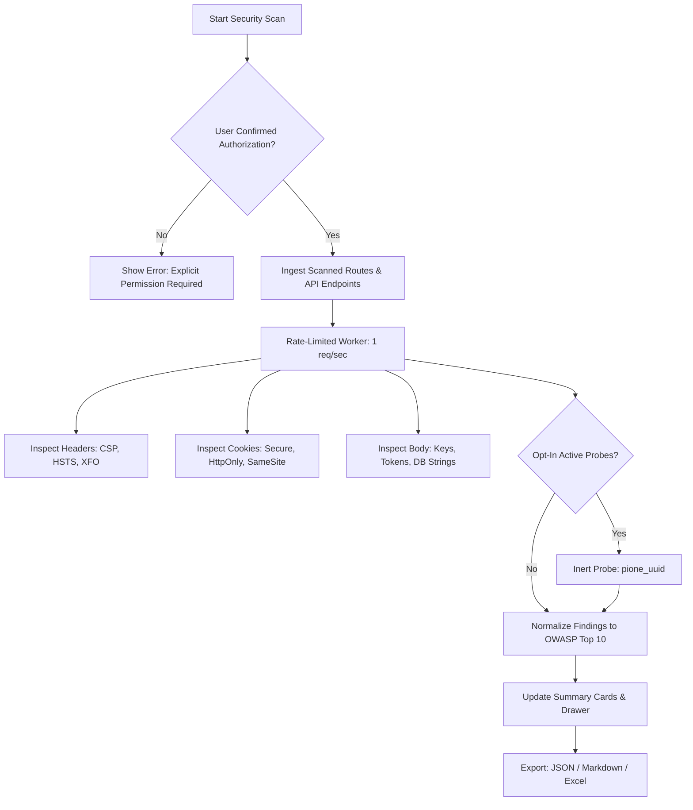
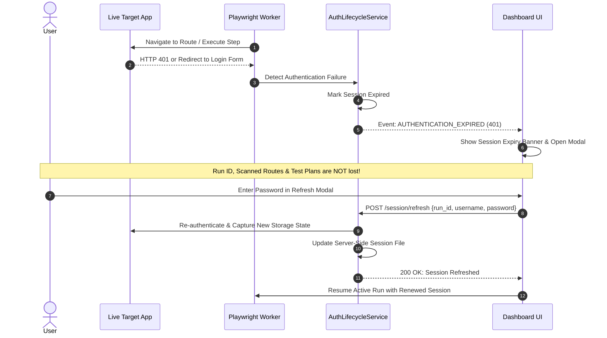
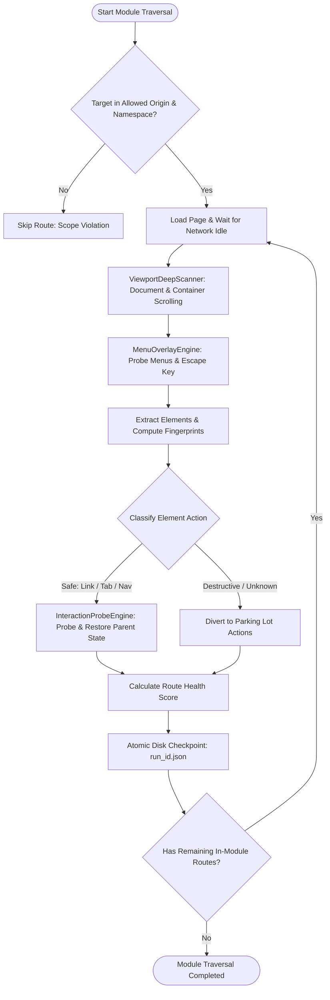
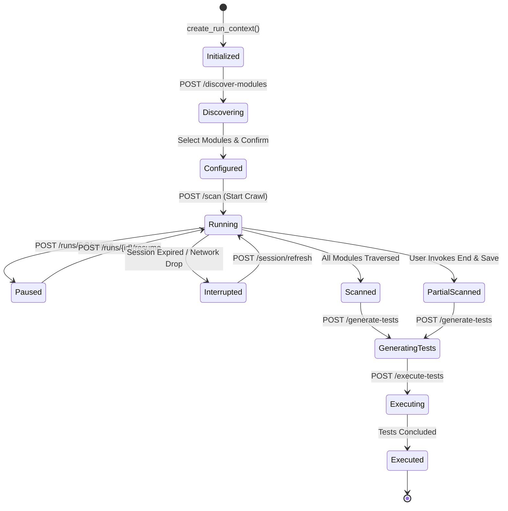

# PiOne Testmate — End-to-End Workflow User Guide & Manual
**Version:** 2.1.0 (Enterprise Lifecycle & Resilient UI Intelligence Edition)  
**Document Classification:** Enterprise Technical Manual & User Guide  
**Release Date:** October 2026  

---

## Table of Contents
1. [Introduction & Core Philosophy](#1-introduction--core-philosophy)
2. [Architecture & System Overview](#2-architecture--system-overview)
3. [Prerequisites & Getting Started](#3-prerequisites--getting-started)
4. [The 8-Step End-to-End Workflow](#4-the-8-step-end-to-end-workflow)
   - [Step 1: Scan Application (Target Specification & Authentication)](#step-1-scan-application-target-specification--authentication)
   - [Step 2: Choose Modules (Navigation Discovery & Boundary Locking)](#step-2-choose-modules-navigation-discovery--boundary-locking)
   - [Step 3: Manual Review (Human-in-the-Loop Safety Checkpoint)](#step-3-manual-review-human-in-the-loop-safety-checkpoint)
   - [Step 4: Crawl Progress & Live Telemetry (Sequential Traversal)](#step-4-crawl-progress--live-telemetry-sequential-traversal)
   - [Step 5: Analyze — UI Intelligence Catalog & Route Health](#step-5-analyze--ui-intelligence-catalog--route-health)
   - [Step 6: Basic Security & DAST Assessment (OWASP Top 10 2021)](#step-6-basic-security--dast-assessment-owasp-top-10-2021)
   - [Step 7: Grounded Test Planning (Neutral AI Gateway)](#step-7-grounded-test-planning-neutral-ai-gateway)
   - [Step 8: Controlled Execution & Per-Step Evidence](#step-8-controlled-execution--per-step-evidence)
   - [Step 9: Audit Reports, 10-Sheet Workbook & Baselines](#step-9-audit-reports-10-sheet-workbook--baselines)
5. [Auxiliary Enterprise Workflows](#5-auxiliary-enterprise-workflows)
   - [Saved Runs & Checkpoint Recovery](#saved-runs--checkpoint-recovery)
   - [Named Regression Suites & Selectable Execution](#named-regression-suites--selectable-execution)
   - [Baseline Comparison & Regression Diffing](#baseline-comparison--regression-diffing)
   - [Artifact Management & Bulk Deletion](#artifact-management--bulk-deletion)
   - [Session Lifecycle & In-Place Renewal](#session-lifecycle--in-place-renewal)
6. [System Workflows & Visual Diagrams](#6-system-workflows--visual-diagrams)
7. [Troubleshooting & Error Classification](#7-troubleshooting--error-classification)

---

## 1. Introduction & Core Philosophy

**PiOne Testmate** is an enterprise-grade, deterministic UI intelligence platform, automated web scanner, and regression automation framework designed for mission-critical web applications.

### Guiding Principle
> **Deterministic Scanner First, AI-Assisted Test Intelligence Second.**  
> Playwright owns the browser discovery, DOM analysis, and execution pipeline deterministically. Artificial Intelligence models (Ollama, Gemini, Claude, OpenAI) are strictly restricted to synthesizing grounded test scenarios from captured DOM element registries and requirements. AI never drives the live browser directly and cannot bypass safety policy guards.

### Core Value Pillars
1. **SSRF Guardrails & Target Isolation**: Non-public IP ranges, internal AWS/GCP metadata endpoints (`169.254.169.254`), loopbacks, and state-destroying URLs (`logout`, `delete`, `reset`) are mathematically blocked at the transport layer.
2. **Deterministic UI State Fingerprinting**: Elements are identified using a resilient 12-attribute registration model with hierarchical selector scoring (Role > ARIA > ID > Text > CSS > XPath).
3. **Destructive Action Parking Lot**: Unsafe buttons (Delete, Terminate, Buy, Submit) are segregated into a reviewable **Parking Lot** where human confirmation is mandatory.
4. **Session Resiliency**: Live sessions are monitored. If a session expires during discovery or execution, an in-place session refresh (`/session/refresh`) preserves all run contexts, discovered routes, and generated test plans.
5. **Audit-Ready Artifacts**: Every crawl and test execution generates a standardized **10-sheet audit-ready Excel workbook**, JSON element registry, YAML schemas, and step-by-step screenshot evidence.
6. **Passive DAST Assessment**: Authorized, non-destructive security review mapped to the **OWASP Top 10 (2021)** standards.

---

## 2. Architecture & System Overview

PiOne Testmate operates as a unified platform consisting of a high-performance **FastAPI asynchronous backend**, a deterministic **Playwright Synchronous Crawler Engine**, a multi-provider **LLM Test Planning Gateway**, a **Relational Repository (SQLite/PostgreSQL)**, and a lightweight **Tailwind CSS single-page interface**.



---

## 3. Prerequisites & Getting Started

### System Requirements
* **Operating System**: Windows 10/11, macOS (Apple Silicon or Intel), or Linux (Ubuntu 22.04+ recommended).
* **Python**: Python 3.11.0 or higher.
* **Browser Runtime**: Pinned Playwright Chromium executable (`playwright==1.64.0`).
* **Memory**: Minimum 4 GB RAM (8 GB recommended for concurrent deep crawling).
* **Network**: Direct network access to the target web application (or local port).

### Installation & Launch

1. **Activate Virtual Environment**:
   ```powershell
   # Windows PowerShell
   .\.venv\Scripts\Activate.ps1
   ```
   ```bash
   # Linux / macOS
   source .venv/bin/activate
   ```

2. **Verify Chromium Executable**:
   PiOne Testmate automatically verifies browser readiness on startup via `/health`. If Chromium is missing:
   ```bash
   .venv/Scripts/python.exe -m playwright install chromium
   ```
   *(Note: The UI displays actionable remediation instructions without exposing raw Python tracebacks.)*

3. **Backend Startup & Port Reliability**:
   Start the FastAPI server on port 8000:
   ```bash
   .venv/Scripts/python.exe -m uvicorn api.main:app --host 127.0.0.1 --port 8000
   ```
   
   > [!TIP]
   > **Resolving Windows `WinError 10013` (Port 8000 Already Bound)**:
   > If Uvicorn fails with `[WinError 10013] An attempt was made to access a socket in a way forbidden by its access permissions`, an orphaned background Python process from a prior session is holding port 8000.
   > Check and terminate safely in PowerShell:
   > ```powershell
   > # Find the process holding port 8000
   > Get-NetTCPConnection -LocalPort 8000 -ErrorAction SilentlyContinue | Select-Object OwningProcess
   > 
   > # Stop only that specific PID safely
   > Stop-Process -Id <PID> -Force
   > ```
   > Port 8000 is not blocked by Windows dynamic NAT exclusions; safe process termination immediately restores server availability.

4. **Localhost vs. Remote Tunnel Proxying**:
   * **Localhost Direct Access** (`http://127.0.0.1:8000` or `http://localhost:8000`): Direct low-latency connection for local QA and testing. If the server is offline, the app prompts to start Uvicorn.
   * **Remote Tunnel Support** (`localtunnel`, `ngrok`): Used to share sessions with colleagues. The tunnel acts strictly as a reverse proxy, not the backend itself. If the tunnel returns `502 Bad Gateway`, verify that localhost:8000 is running and that the tunnel URL matches before restarting both services.

5. **Access the Dashboard**:
   Open your browser to: **[http://127.0.0.1:8000/](http://127.0.0.1:8000/)**  
   Interactive Swagger API Documentation: **[http://127.0.0.1:8000/docs](http://127.0.0.1:8000/docs)**

---

## 4. The 8-Step End-to-End Workflow



---

### Step 1: Scan Application (Target Specification & Authentication)

In Step 1, the user initializes the target boundary, selects the assessment flow, and configures credentials.

* **Target URL Input (`#url-input`)**: Fully qualified HTTP or HTTPS address (e.g., `https://www.saucedemo.com`).
* **Execution Mode Switcher (`#target-mode-toggle`)**:
  * **Live Target Scan (`isLive = true`)**: Launches a real Playwright Chromium browser instance, validates SSL certificates, enforces strict SSRF boundary rules, authenticates via form submission, probes interactive controls, records network telemetry, and captures full-resolution screenshots. Displayed in the Persistent Active Run Bar with a blue `LIVE SCAN` badge.
  * **Mock Demo Simulation (`isLive = false`)**: A 100% offline, deterministic simulation of the complete 8-step pipeline without external network calls or browser processes. Generates mock route graphs (5 routes, 47 UI elements) and simulated step executions for UX evaluation, training, and unit verification. Displayed with a purple `MOCK DEMO` badge.
* **Assessment Flow Modes (`#assessment-mode-first` / `#assessment-mode`)**:
  * **Both Functional & Security Review (`both`)**: Default mode. Traverses all modules, constructs the UI intelligence catalog in Analyze, provides optional passive security assessment, and advances seamlessly into test planning, execution, and regression reporting.
  * **Functional Testing Only (`functional_only`)**: Focuses purely on functional test planning, execution, and regression suites. Completely disables and hides the security assessment panel in Step 5 (`aria-hidden="true"`).
  * **Security Review Only (`security_only` / `vapt_only`)**: Focuses strictly on authorized passive DAST / OWASP Top 10 security review after crawling. Functional test planning is bypassed, allowing immediate access to security findings and exports without requiring test plan creation.
  * *Mode Persistence Guarantee*: The selected mode is stored in `localStorage` and `RunContext.assessment_mode`. It persists across all steps and page reloads, only resetting when the user explicitly triggers a **New Scan**.
* **Authentication Credentials**:
  * **Username (`#username-input`)**
  * **Password (`#password-input`)** with toggle reveal (`#btn-toggle-password`) and instant credential wiper (`#btn-clear-creds`).
  * *Security Guarantee*: Passwords are redacted from telemetry, disk checkpoints, Excel reports, and JSON payloads.
* **Action Button**: Click **Discover Modules** (`#btn-discover`).



---

### Step 2: Choose Modules (Navigation Discovery & Boundary Locking)

Step 2 presents all top-level functional modules discovered by the passive menu crawler.

* **Module Inventory Grid (`#module-options-container`)**:
  * Displays discovered modules with route path, selector source, and component counts.
* **Selection Controls**:
  * **Select All** (`#btn-modules-select-all`): Selects the entire application footprint.
  * **Clear All** (`#btn-modules-clear-all`): Clears selections.
  * **Module Checkboxes (`input[name="mod-check"]`)**: Individual granular module targeting (e.g., select only `Inventory` and `Cart`, excluding `Admin`).
* **Selection Summary Chips (`#selected-modules-chips`)**: Displays selected module pills with instant removal.
* **Validation**: PiOne Testmate requires at least one selected module before continuing.
* **Action Button**: Click **Confirm & Review** (`#btn-modules-continue`).

---

### Step 3: Manual Review (Human-in-the-Loop Safety Checkpoint)

Step 3 acts as the pre-crawl governance gate.

* **Target Scope Review (`#review-module-list`)**:
  * Displays the selected module boundaries and root paths.
* **Safety Guardrails Summary**:
  * **Safe Action Discovery**: Links, tabs, accordions, and pagination are probed without mutations.
  * **Destructive Action Parking**: Buttons matching keywords (`delete`, `remove`, `pay`, `purchase`, `submit`, `cancel`) are diverted to the Parking Lot.
  * **Sequential Traversal**: Modules are crawled sequentially with scroll position restoration and isolation.
  * **Atomic Checkpoints**: Checkpoints are written to disk before and after every child route.
* **Action Button**: Click **Start Deep Crawl** (`#btn-start-crawl`).

---

### Step 4: Crawl Progress & Live Telemetry (Sequential Traversal)

Step 4 streams real-time Playwright exploration events via WebSockets / Server-Sent Events.

* **Live Telemetry Indicators**:
  * **Scan Status Pill (`#scan-status-badge`)**: Displays `running`, `paused`, or `scanned`.
  * **Module Progress (`#live-module-progress`)**: Shows completed vs total modules (e.g., `2 / 3`).
  * **Route Progress (`#live-route-progress`)**: Shows completed vs pending routes.
  * **Elements Discovered (`#live-element-count`)**: Real-time counter of registered buttons, inputs, dropdowns, and tables.
* **Interactive Scan Controls**:
  * **Pause Scan (`#btn-scan-pause`)**: Halts crawling at the next safe boundary.
  * **Resume Scan (`#btn-scan-resume`)**: Resumes exploration from the active checkpoint.
  * **End Scan & Save (`#btn-scan-end-save`)**: Gracefully terminates the crawl and packages all partial results as valid artifacts.
  * **Discard Run (`#btn-scan-discard`)**: Cancels the run and removes partial runtime state.
* **Completion Milestone**:
  * When exploration concludes, the terminal state is reconciled:
    * `status = scanned`
    * Completed modules = Total selected modules
    * Pending routes = `0`
    * Active route is cleared
    * **View Analysis** button (`#btn-view-analysis`) is enabled.
    * Pause and End buttons are disabled.
  * *Important Constraint*: The UI never auto-advances to Step 5; user must click **View Analysis**.

---

### Step 5: Analyze — UI Intelligence Catalog & Route Health

Step 5 presents the complete structural decomposition of the application.

* **Route Health & Scoring Table**:
  * **WORKING (Score >= 70)**: High DOM stability, responsive interactions, 0 console/network errors.
  * **PARTIAL (Score 40-69)**: Minor warnings, slow responses, or non-critical redirects.
  * **NON-WORKING (Score < 40)**: Blank screens, 4xx/5xx HTTP responses, or fatal JavaScript errors.
* **12-Attribute Element Identity Registry**:
  Every interactive element displays:
  1. `element_id` (deterministic SHA-256 fingerprint)
  2. `tag_name` (`button`, `a`, `input`, `select`)
  3. `element_role` (WAI-ARIA accessibility role)
  4. `accessible_name` / Text
  5. `id_attribute`
  6. `name_attribute`
  7. `data_testid` / `data-cy` attributes
  8. `css_selector`
  9. `xpath_selector`
  10. `bounding_box` (`x`, `y`, `width`, `height`)
  11. `visibility_state` (visible, obscured, scroll-required)
  12. `selector_confidence_score` (1-100)
* **Parking Lot Review**:
  * Displays blocked destructive actions with screenshot previews, element selectors, and reason for exclusion.
* **Action Button**: Click **Proceed to Test Generation** (`#btn-analyze-proceed`).

---

### Step 6: Basic Security & DAST Assessment (OWASP Top 10 2021)

Located in Step 5 as an integrated sub-panel, this provides authorized, passive/low-impact Dynamic Application Security Testing (DAST).

* **Strict Safety Controls**:
  * **Passive Checks Only**: Zero destructive attacks, no password fuzzing, no deletion, no brute force, no DoS.
  * **Target Origin Lock**: Off-target links and external CDNs are never requested.
  * **Strict Pacing**: 1 request per second with a 20-request / 120-second budget.
* **Evaluated Security Categories**:
  1. **Security Headers (`headers`)**: Content-Security-Policy (CSP), HSTS, X-Content-Type-Options, Referrer-Policy, Permissions-Policy, X-Frame-Options/framing protection.
  2. **Cookie Attributes (`cookies`)**: Verifies `Secure`, `HttpOnly`, and `SameSite` flags.
  3. **Mixed Content (`mixed_content`)**: Identifies insecure HTTP resources or forms on HTTPS origins.
  4. **CORS Misconfiguration (`cors_probe`)**: Detects wildcard `*` with credentials or reflected origin trust.
  5. **Sensitive Information Disclosure (`disclosure`)**: Flags exposed private keys, AWS/GitHub tokens, JWT tokens in bodies, database connection strings, and source maps.
  6. **Error Disclosure (`error_disclosure`)**: Detects verbose stack traces and debug toolbar leaks.
  7. **Authorization Boundary (`auth_boundary`)**: Flags whether protected endpoints return 200 without authentication.
  8. **Inert Reflection Canary (`reflection_canary`)**: Opt-in harmless alphanumeric marker `pione_<uuid>` to verify output encoding without exploit payloads.
* **UI Features**:
  * Summary cards by severity: **High** (Red), **Medium** (Amber), **Low** (Yellow), **Informational** (Blue).
  * Filterable findings list by severity and keyword search.
  * Collapsible finding detail drawer displaying evidence snippets, remediation guidance, and reproduction-safe request metadata (`GET /path` with credentials stripped).
  * Direct exports: **JSON**, **Markdown**, and **Excel (.xlsx)**.



---

### Step 7: Grounded Test Planning (Neutral AI Gateway)

Step 7 generates grounded, deterministic test cases using your preferred AI engine or offline rule engine.

* **Neutral Multi-Provider Gateway**:
  * **Deterministic Generator**: 100% offline, zero-token, rule-based planner. Always available.
  * **Ollama (Local LLM)**: Connects to local models (e.g., `llama3`, `mistral`, `qwen2.5-coder`) via `http://localhost:11434`. Complete data privacy.
  * **Google Gemini API**: Cloud inference via Gemini Pro / Flash.
  * **Anthropic Claude API**: Cloud inference via Claude 3.5 Sonnet.
  * **OpenAI API**: Cloud inference via GPT-4o / GPT-4o-mini.
* **Requirement & QA Excel Context Ingestion (`#upload-requirements` & `#upload-testcases`)**:
  * **Upload Requirements Document**: Ingests user stories, acceptance criteria, or specification documents in `.txt`, `.md`, `.json`, or `.csv` format.
  * **Upload Pre-existing QA Test Cases (`.xlsx`, `.csv`)**: Upload existing enterprise test case matrices. PiOne Testmate parses uploaded test cases, matches steps against discovered DOM element selectors, and executes rows deterministically line-by-line in uploaded sequence.
  * **Testing Scenario Prompt**: Custom focus prompt (e.g., *"Focus on inventory item navigation, cart badge count, and catalogue filters"*).
* **Deterministic Grounding & Fallback Transparency**:
  * Every planned step is grounded in real, crawled UI targets. If an AI provider (Ollama, Gemini) times out, encounters quota limits, or generates ungrounded selectors, PiOne Testmate automatically falls back to the deterministic engine.
  * The UI explicitly displays the grounding status (`X scan targets linked`), provider availability badge (`Grounded AI Active` vs `Fallback Active`), and exact fallback rationale.
  * Switching providers initiates a fresh request without stale loading states or duplicate submissions.
* **Action Button**: Click **Generate Test Plan** (`#btn-generate-plan`).

---

### Step 8: Controlled Execution & Per-Step Evidence

Step 8 executes generated test plans against the live application using Playwright.

* **Safe Action Execution**:
  * Safe navigation, clicking safe links/buttons, entering non-destructive text, selecting dropdowns, and asserting visibility.
  * Destructive parking-lot actions remain locked.
* **Per-Step Evidence Capture**:
  * **Locator Used**: Records the exact locator engine that succeeded (`role`, `aria`, `id`, `text`, `css`, or `xpath`).
  * **Step Screenshots**: Automatic screenshot captured for every single test step (`{tc_id}_{step_id}.png`).
  * **Inline Evidence Modal (`#screenshot-modal`)**: Click any step's thumbnail to inspect full-resolution screenshot evidence.
  * **Console & Network Errors**: JavaScript runtime errors and failed network calls (4xx/5xx) are captured and attached to the test step.
* **Individual Step Rerun (`#btn-rerun-step`)**:
  * Re-executes an isolated failing step without having to rerun the entire multi-suite regression.

---

### Step 9: Audit Reports, 10-Sheet Workbook & Baselines

Step 9 provides unified audit packages, reporting dashboards, and baseline savers.

#### Comprehensive 12-Sheet Enterprise Audit Workbook (`.xlsx`)
Every completed run produces a standardized multi-sheet Excel report that combines deep crawl intelligence, QA matrices, and step-level execution telemetry:
1. `Route Health`: Canonical overview of all routes with health scores, HTTP status, load timings, and stability flags.
2. `working_routes`: Operational routes meeting enterprise criteria (Score >= 70).
3. `partial_routes`: Bounded or degraded routes (Score 40-69).
4. `non_working_routes`: Broken or unreachable routes (Score < 40).
5. `menu_hierarchy`: Discovered global navigation tree with depth levels and selector roots.
6. `element_map`: Complete 12-attribute inventory of all discovered DOM controls and selectors.
7. `parking_lot_actions`: Segregated destructive controls requiring explicit human authorization.
8. `scan_events`: Timestamped telemetry events capturing the entire crawling lifecycle.
9. `test_cases`: Grounded test plan cases, modules, descriptions, and step sequences.
10. `Test Execution`: Complete step-by-step execution results. Includes both application fields (`TC_ID`, `Step_ID`, `Action`, `Expected_Result`, `Actual_Result`, `Status`, `failure_category`, `locator_used`, `Artifact_Path`) and QA audit matrix fields (`Testcase Id`, `Steps to Execute`, `Test Status`, `Severity`, `BUG Status`, `Notes / Reason`).
11. `execution_results`: Raw tabular execution records formatted for programmatic CI/CD ingestion.
12. `coverage_gaps`: Unmapped requirements, orphan controls, and recommended coverage improvements.

#### Status Badges & Meaning
* **Active Run Bar**:
  * `LIVE SCAN`: Real browser execution active against a live network target.
  * `MOCK DEMO`: Deterministic offline simulation active.
  * Status badges: `IDLE`, `IN_PROGRESS` (blue), `COMPLETED` / `SCANNED` (green), `PAUSED` (amber), `FAILED` (red).
* **Route Health Badges**:
  * `WORKING` (green): 100% page load success, DOM stable, 0 console/network errors.
  * `PARTIAL` (amber): Bounded traversal completed with warnings or partial extraction.
  * `NON_WORKING` (red): HTTP 4xx/5xx errors or unreachable routes.
* **Step Execution Badges**:
  * `Pass` (emerald): Action and assertions succeeded; locator verified and screenshot captured.
  * `Fail` (rose): Action failed or timed out. Accompanied by exact `failure_category` and error trace.
  * `Skipped` (slate): Step bypassed due to a previous step failure in the same test case.

#### Grouped Report Downloads
* **Primary Audit Package**:
  * Download 10-Sheet Excel Workbook (`#btn-dl-excel`)
  * Download JSON Intelligence Catalog (`#btn-dl-json`)
  * Download YAML Schema Definition (`#btn-dl-yaml`)
  * Download Markdown Executive Summary (`#btn-dl-markdown`)
* **Technical Execution Evidence**:
  * Download Execution Results JSON (`#btn-dl-exec`)
  * Download Checkpoint State (`#btn-dl-checkpoint`)
  * Download Screenshots ZIP (`#btn-dl-screenshots`)
  * Download Generated Pytest Script (`#btn-download-script`)

#### Save Reusable Baseline
* Click **Save as Baseline** (`#btn-save-baseline`). Enter a baseline name (e.g., `v2.1-release-candidate`).
* Preserves the scan graph and test results as an immutable benchmark for future pull request regression diffs.

---

## 5. Auxiliary Enterprise Workflows

### Saved Runs & Checkpoint Recovery
Access via the **Saved Runs** top-level tab (`#view-saved-runs`).
* Displays all historical runs persisted in SQLite/PostgreSQL.
* Metrics: Run ID, Target URL, Status, Progress %, Completed/Pending Modules, Discovered Routes, and Timestamps.
* **Actions Available**:
  * **Resume Scan**: Reconnects to an interrupted or paused crawl and resumes traversal from the last checkpoint.
  * **Open Results**: Loads the run's saved state into Analyze and Report views.
  * **Duplicate as New Run**: Clones module selections and target parameters into a fresh `run_id`.
  * **Archive Run**: Safely flags run as archived.
  * **Discard Run**: Removes the run from the database.

---

### Named Regression Suites & Selectable Execution
Access via the **Regression Suites** top-level tab (`#view-suites`).
* **Create Suite (`#btn-create-suite`)**: Group tests by module, tag (`smoke`, `regression`, `critical`), or environment.
* **Selectable Test Execution & Single-Click Launch**:
  * When entering Step 7, all generated tests are automatically selected and populated in the execution table on the very first view.
  * Filter tests by module, tag, or execution state (`All`, `Failed`, `Changed`, `Review`).
  * **Pre-Execution Safety Modal (`#exec-confirm-modal`)**: Clicking **Execute Selected Tests** opens an explicit safety confirmation displaying the exact count of tests and steps to be executed against the target URL. Checking the authorization box and clicking **Confirm & Execute** launches the Playwright worker immediately without redundant clicks.
  * **Per-Step Execution Outcomes**: Each step is strictly classified as `Pass`, `Fail`, or `Skipped` with granular failure categories (`timeout`, `element_not_found`, `assertion_mismatch`, `navigation_error`) and exact locator engines logged without suppressing or converting errors.
* **Typed `DELETE` Confirmation**:
  * Bulk deletion of all suites (`#btn-delete-all-suites`) requires typing `DELETE` into a modal input, preventing accidental data loss.

---

### Baseline Comparison & Regression Diffing
* Compare any active run against a previously saved baseline using **Compare Baseline** (`#btn-compare-baseline`).
* **Regression Diff Engine calculates**:
  * **Status Changes**: Tests that changed from `PASSED` to `FAILED` or vice-versa.
  * **Newly Discovered Routes**: Routes present in the new run but absent in the baseline.
  * **Missing / Broken Routes**: Routes present in the baseline that failed or were missing.
  * **DOM Fingerprint Drifts**: Changed selectors or relocated interactive elements.

---

### Artifact Management & Bulk Deletion
Access via the **Artifacts** top-level tab (`#view-artifacts`).
* Catalogs runs that possess downloadable generated disk files.
* **Bulk Cleanup (`#btn-delete-all-artifacts`)**:
  * Protected by the typed `DELETE` confirmation dialog.
  * Safely purges temporary screenshots, JSON artifacts, and Excel workbooks from disk while preserving audit records and database schema integrity.

---

### Session Lifecycle & In-Place Renewal



---

## 6. System Workflows & Visual Diagrams

### End-to-End Traversal & Parking Lot Engine



---

### Run Context Lifecycle & State Transitions



---

## 7. Troubleshooting & Error Classification

PiOne Testmate enforces structured, machine-readable error categories:

| Error Category | HTTP Code | Root Cause | User Remediation |
| :--- | :---: | :--- | :--- |
| `DISCOVERY_UNAVAILABLE` | **503 / 502** | Playwright Chromium executable missing or target network unreachable. | If missing browser: Run `.venv\Scripts\python.exe -m playwright install chromium`. If network: verify target URL is online. |
| `LOGIN_FAILED` | **422** | Invalid username/password or unrecognized login form layout. | Re-check credentials. Ensure target login form uses standard `input[type="password"]`. |
| `AUTHENTICATION_EXPIRED` | **401** | Session token expired during crawling or test execution. | Click **Refresh Session** in the modal, re-enter password, and resume without losing data. |
| `SCOPE_VIOLATION` | **400** | Requested route navigated outside the base origin or to an internal IP (SSRF). | Ensure target URL matches application origin. Cross-domain crawls are blocked by design. |
| `CRAWL_INTERRUPTED` | **500** | Browser crash, process kill, or network disconnection. | Navigate to **Saved Runs**, find the run, and click **Resume Scan** to recover from checkpoint. |
| `PROVIDER_UNAVAILABLE` | **502 / 504**| Selected LLM provider timed out or returned invalid credentials. | Switch to **Deterministic Planning** (offline) or check Ollama / API keys in Settings. |
| `RUN_ACTIVE_CONFLICT` | **409** | Attempted to start a scan on an already running run ID. | Reconnect to active run using the top banner `#btn-return-current-run`. |

---
*PiOne Testmate Technical Documentation Team &bull; Enterprise Automation Platform v2.1.0*
