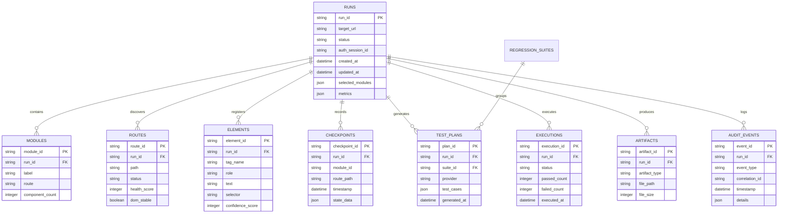

# Software Requirements Specification (SRS) & Product Requirements Document (PRD)
**Project Title:** PiOne Testmate — Enterprise UI Automation Intelligence & Security Testing Platform  
**System Version:** 2.1.0 (Enterprise Lifecycle & Session Resiliency Edition)  
**Document Status:** Approved & Baseline Verified  
**Date:** October 2026  

---

## 1. Executive Summary & Product Vision

### 1.1 Purpose
This document establishes the official software requirements specification for **PiOne Testmate**, an enterprise-grade automated UI crawler, deterministic test planner, regression execution engine, and passive security assessment platform. It defines both functional and non-functional requirements to guide engineering, testing, compliance auditing, and stakeholder validation.

### 1.2 Product Vision
Traditional automated testing tools suffer from three fundamental limitations:
1. **Flaky Selector Brittleness**: Test scripts break whenever developers tweak CSS classes, layout wrappers, or text labels.
2. **Ungrounded AI Hallucinations**: Generative AI tools attempting to drive web browsers frequently execute destructive operations (accidental checkout, data deletion) or hallucinate non-existent DOM elements.
3. **Session Fragility**: Long-running end-to-end regression suites fail catastrophically when authentication tokens expire mid-test.

**PiOne Testmate solves these challenges through a strict architectural principle:**
> **Deterministic Scanner First, AI-Assisted Test Intelligence Second.**  
> Playwright manages all browser discovery, viewport scrolling, overlay expansion, and element fingerprinting deterministically. AI models (Ollama, Gemini, Claude, OpenAI) synthesize grounded test plans based strictly on verified DOM element registries. Dangerous mutations are safely segregated into a human-governed **Parking Lot**, while the **Session Lifecycle Guard** allows in-place session refresh without losing test data.

---

## 2. System Stakeholders & User Personas

| Persona | Role | Primary Goals in Platform | Key Pain Points Addressed |
| :--- | :--- | :--- | :--- |
| **QA Automation Engineer / SDET** | Primary User | Rapidly discover application routes, extract UI elements, generate executable test plans, and run automated regression suites. | Eliminates manual locator creation; automatically generates deterministic, selector-resilient tests with per-step screenshots. |
| **Security QA / DevSecOps Engineer** | Security User | Perform automated, passive, authorized DAST assessments on internal web applications mapped to OWASP Top 10 standards. | Identifies missing security headers, weak cookies, CORS leaks, and token exposures without risking destructive database changes. |
| **QA Lead / Test Manager** | Reviewer & Governance | Review route health, track module coverage, compare test results against regression baselines, and review destructive actions in the Parking Lot. | Access to comprehensive 10-sheet audit-ready Excel workbooks, visual diff reports, and traceable historical run context. |
| **DevOps / CI/CD Architect** | Integrator | Integrate automated scanning and regression replays into continuous integration pipelines via CLI and headless test runners. | Headless Playwright engine, SQLite/PostgreSQL persistence, and exit-code reporting for automated build gates. |

---

## 3. Operational Boundaries & Non-Negotiable Safety Constraints

To guarantee enterprise compliance and prevent operational disruption, the following architectural constraints are strictly enforced:

1. **SSRF & Network Boundary Protection**:
   - The scanner **MUST** reject any target URL or child link that resolves to private network ranges (RFC 1918 `10.0.0.0/8`, `172.16.0.0/12`, `192.168.0.0/16`), IPv4/IPv6 loopbacks (`127.0.0.1`, `::1`), link-local metadata services (`169.254.169.254`), non-HTTP schemes (`file://`, `data://`), or external third-party origins.
   - An explicit bypass flag (`ALLOW_LOCAL_TARGETS=1` or `SECURITY_LAB_ORIGIN`) is permitted strictly in local automated test suites.
2. **Zero Destructive AI Browser Control**:
   - Generative AI models **MUST NEVER** be granted direct browser execution access or raw execution handles. All live browser actions are filtered, bounded, and dispatched through deterministic Playwright drivers.
3. **Destructive Action Parking Lot**:
   - Any interactive element matching high-risk regex patterns (`delete`, `remove`, `destroy`, `terminate`, `pay`, `purchase`, `checkout`, `reset`, `logout`, `cancel`) **MUST BE DIVERTED** to the Parking Lot. The crawler is strictly prohibited from clicking parked actions automatically.
4. **State-Changing URL Exclusion**:
   - Traversal URLs matching `logout`, `signout`, `destroy`, or `reset-password` **MUST BE EXCLUDED** from automated crawling to avoid unintended session termination.
5. **Zero Credential / Token Persistence**:
   - User passwords, authentication tokens, session cookies, and private API keys **MUST NEVER** be stored in client-side `localStorage`, `sessionStorage`, browser history, query strings, or unredacted log files.

---

## 4. Functional Requirements (FR)

### FR-1: Target Specification & SSRF Guardrails
* **Description**: The system shall accept a target URL, validate origin syntax, and enforce strict SSRF security guardrails.
* **Inputs**: Target URL string, optional credentials (username/password), execution mode (Live Target vs Mock Demo).
* **Processing**:
  * Parse URL scheme, host, and port. Reject non-HTTP(S) schemes.
  * Resolve DNS host to IP. Query `ipaddress.is_global`. Block RFC 1918 private IPs, loopback, multicast, and cloud metadata (`169.254.169.254`).
  * Initialize an immutable `RunContext` with a unique UUID (`run_id`).
* **Outputs**: Initialized `RunContext` object, persisted to memory cache and atomic `.json` file.
* **Acceptance Criteria**: Any attempt to scan `127.0.0.1` or `169.254.169.254` (without local lab flag) returns `HTTP 400 Bad Request` with category `SCOPE_VIOLATION`.

### FR-2: Public & Authenticated Module Discovery
* **Description**: The system shall passively discover top-level application navigation without crawling child pages.
* **Inputs**: Target URL, optional username and password.
* **Processing**:
  * If credentials provided: launch Playwright, locate login forms (`input[type="password"]`), submit credentials, and verify authenticated session.
  * If no credentials provided: load public landing page.
  * Extract sidebar items, top navigation bars, and menu tabs. Assign unique module IDs (`mod_1`, `mod_2`).
* **Outputs**: `ModuleDiscoveryResponse` containing discovered module IDs, labels, root routes, and component counters.
* **Acceptance Criteria**: Discovery executes in under 15 seconds. If login fails, returns `HTTP 422 Unprocessable Entity` with category `LOGIN_FAILED`.

### FR-3: Interactive Module Boundary Selection
* **Description**: The system shall allow the user to select one, multiple, or all discovered modules for targeted scanning.
* **Inputs**: Array of selected module IDs (`selected_module_ids`).
* **Processing**:
  * Validate that at least one module ID is selected.
  * Lock the `RunContext.selected_modules` boundary to the chosen subset.
* **Outputs**: Updated `RunContext` with locked module scope.
* **Acceptance Criteria**: Deselected modules and their child routes are excluded from subsequent crawling.

### FR-4: Human-in-the-Loop Manual Review Checkpoints
* **Description**: The system shall present a pre-crawl summary of targeted modules, exploration policies, and safety parameters.
* **Inputs**: User confirmation action.
* **Processing**:
  * Display confirmed module paths, safe action discovery rules, and parking-lot policies.
* **Outputs**: Authorization token to initiate Step 4 crawl.
* **Acceptance Criteria**: Crawling does not commence without explicit user confirmation (`btn-start-crawl`).

### FR-5: Deterministic Deep Playwright Crawling
* **Description**: The system shall traverse discovered routes sequentially, extracting interactive UI elements, handling scrolling, and capturing overlays.
* **Processing Pipeline**:
  1. Scope verification and document guard installation.
  2. Page and network stabilization via mutation observers (`networkidle`).
  3. Base UI state fingerprinting.
  4. Viewport deep-scrolling (`ViewportDeepScanner`) for lazy-loaded content.
  5. Nested scrollable container exploration.
  6. Menu, submenu, and dropdown overlay capture with clean Escape closure.
  7. Candidate action classification (`ActionClassifier`).
  8. Safe button probing (`InteractionProbeEngine`) with parent state restoration.
  9. Bounded child route traversal (maximum depth: 5).
  10. Atomic checkpoint writing before and after every route.
* **Outputs**: Real-time telemetry events (`scan_started`, `module_started`, `route_discovered`, `route_completed`, `scan_completed`).
* **Acceptance Criteria**: The crawler isolates each module, restores scroll positions, and enforces a hard per-route timeout of 30 seconds.

### FR-6: UI Intelligence Catalog & Route Health Scoring
* **Description**: The system shall analyze discovered routes and interactive elements, computing deterministic health scores and element fingerprints.
* **Element Registration Model**:
  * Registers elements with 12 attributes: `element_id`, `tag_name`, `role`, `text`, `id`, `name`, `data_testid`, `css`, `xpath`, `bounding_box`, `visibility`, and `confidence_score`.
* **Route Health Scoring Engine**:
  * Evaluates DOM stability, network errors, console exceptions, and interaction success.
  * Categories: **WORKING** (Score >= 70), **PARTIAL** (Score 40-69), **NON-WORKING** (Score < 40).
* **Outputs**: Normalized Route Intelligence Catalog and Parking Lot inventory.
* **Acceptance Criteria**: Route counts on summary cards match table rows exactly.

### FR-7: Safe Passive Security & DAST Assessment
* **Description**: The system shall conduct an authorized, passive DAST security evaluation against scanned same-origin endpoints.
* **Evaluation Categories (OWASP Top 10 2021)**:
  * Missing security headers (CSP, HSTS, X-Content-Type-Options, Referrer-Policy, Permissions-Policy, X-Frame-Options).
  * Cookie security attributes (`Secure`, `HttpOnly`, `SameSite`).
  * Mixed content detection (HTTP resources on HTTPS pages).
  * Insecure CORS configurations (wildcard origin with credentials).
  * Sensitive data disclosure (private keys, AWS/GitHub tokens, JWTs, DB connection strings, source maps).
  * Error disclosure (verbose stack traces, debug toolbars).
  * Authorization boundaries on protected routes.
  * Opt-in inert reflection canary (`pione_<uuid>`).
* **Outputs**: Normalized VAPT findings with severity (`High`, `Medium`, `Low`, `Info`), sanitized evidence, remediation steps, and reproduction-safe request metadata.
* **Acceptance Criteria**: Requests are strictly paced at 1 req/sec; zero mutation or credential attacks performed.

### FR-8: Grounded Multi-Provider Test Planning Gateway
* **Description**: The system shall generate grounded test cases using an extensible AI gateway or deterministic rule engine.
* **Supported Providers**:
  * `deterministic`: Offline rule-based generator.
  * `ollama`: Local open-weights model gateway (`http://localhost:11434`).
  * `gemini`: Google Gemini Pro / Flash API.
  * `claude`: Anthropic Claude 3.5 Sonnet API.
  * `openai`: OpenAI GPT-4o / GPT-4o-mini API.
* **Grounded Requirement Binding**:
  * Every generated step must bind to a verified `element_id` and selector from Step 5.
* **Outputs**: Structured test plan (`GeneratedTestResponse`) containing test cases, steps, descriptions, expected results, and tags.
* **Acceptance Criteria**: Invalid or hallucinated selectors are rejected; generated test cases compile to valid Pytest scripts.

### FR-9: Controlled Test Execution & Evidence Capture
* **Description**: The system shall execute safe generated test cases, capturing per-step locators and screenshot evidence.
* **Processing**:
  * Launch clean browser context with stored authentication state.
  * Execute step actions: `navigate`, `click`, `fill`, `assert_visible`.
  * Record exact locator engine used (`role`, `aria`, `id`, `text`, `css`, `xpath`).
  * Capture full-fidelity per-step screenshot (`{tc_id}_{step_id}.png`).
  * Log console errors and network failures.
  * Support single-step rerun (`POST /rerun-step`).
* **Outputs**: Detailed execution results with step-by-step pass/fail verdicts and screenshot links.
* **Acceptance Criteria**: Step execution failures capture screenshots and detailed locator diagnostic messages without terminating the suite.

### FR-10: Audit-Ready Multi-Format Reporting
* **Description**: The system shall generate standardized audit reports and a 10-sheet Excel workbook.
* **Outputs**:
  * **10-Sheet Workbook**: `working_routes`, `partial_routes`, `non_working_routes`, `menu_hierarchy`, `element_map`, `parking_lot_actions`, `scan_events`, `test_cases`, `execution_results`, `coverage_gaps`.
  * **Artifact Files**: JSON element catalog, YAML schemas, Markdown summary, Screenshots ZIP, and executable Pytest script.
* **Acceptance Criteria**: Excel workbook formulas are sanitized to prevent CSV/formula injection vulnerabilities; all sheets are cleanly formatted with frozen header panes.

### FR-11: Durable State Persistence & Resumable Runs
* **Description**: The system shall persist runs, routes, elements, checkpoints, and test results in a relational database.
* **Processing**:
  * Support SQLite (default local) and PostgreSQL (via `DATABASE_URL`).
  * Auto-save state after every route and module.
  * Provide **Saved Runs** dashboard with Resume, Duplicate, Archive, and Discard actions.
* **Outputs**: Persistent records in relational tables (`runs`, `modules`, `routes`, `elements`, `checkpoints`, etc.).
* **Acceptance Criteria**: Server restart preserves partial runs; resuming an interrupted run resumes from the last completed checkpoint.

### FR-12: Regression Suites, Baselines & Replay Diff Engine
* **Description**: The system shall enable creating named regression suites, saving baselines, and diffing test runs.
* **Processing**:
  * Create suites filtered by module, tag, or environment.
  * Selectively execute specific tests with an explicit confirmation modal.
  * Compare run against saved baseline: compute status transitions (`PASSED` -> `FAILED`), newly discovered routes, and selector drift.
* **Outputs**: Regression comparison report with visual diff summary.
* **Acceptance Criteria**: Bulk deletion of regression suites requires typing `DELETE` in the confirmation modal.

---

## 5. Non-Functional Requirements (NFR)

### NFR-1: Performance & Bounded Budgets
* **Scan Pacing**: Crawling and probing operations must respect a configurable pacing delay (minimum 100ms between actions).
* **Timeouts**:
  * Page navigation timeout: 30 seconds maximum.
  * Step execution timeout: 10 seconds maximum.
  * LLM test plan generation timeout: 60 seconds (cloud) / 90 seconds (local Ollama).
  * Security review budget: 20 requests / 120 seconds maximum.
* **Memory Management**: Maximum response body inspected by security scanner capped at 256 KiB.

### NFR-2: Security & Privacy (Confidentiality & Integrity)
* **Zero Credential Leakage**: Passwords and raw session cookies are masked in logs and reports (`[REDACTED]`).
* **Content Security Policy**: The application server serves strict security headers (`X-Content-Type-Options: nosniff`, `X-Frame-Options: DENY`, `Referrer-Policy: strict-origin-when-cross-origin`).
* **Destructive Operation Safeguards**: All bulk deletions (`Delete All Suites`, `Delete All Artifacts`) must enforce explicit typed confirmation (`DELETE`).

### NFR-3: Reliability & Fault Tolerance
* **Atomic Checkpointing**: Checkpoints must be written to temporary files and atomically renamed (`.tmp` -> `.json`) to prevent corruption during unexpected shutdowns.
* **Idempotent Telemetry**: Telemetry events must carry monotonic sequence numbers to prevent out-of-order rendering on client reconnects.
* **Duplicate Run Prevention**: The API must return `HTTP 409 Conflict` if a duplicate start request is received for an already active run.

### NFR-4: Usability & Accessibility (WCAG AA Compliance)
* **Responsive Viewport Support**: The 8-step navigation stepper must render smoothly across desktop (1440px), tablet (1024px/768px), and mobile (375px) using single-row horizontal scrolling.
* **High Contrast & Visual Focus**: Interactive elements must feature visible 2px blue focus rings (`#2563eb`). Text contrast ratio must meet or exceed WCAG AA 4.5:1.
* **Keyboard Accessibility**: All 8 application modals must trap `Tab` focus and dismiss cleanly upon pressing the `Escape` key.
* **Live Regions**: Telemetry status pills must declare `aria-live="polite"` for screen readers.

### NFR-5: Auditability & Compliance
* Every run context must capture timestamped audit events with millisecond precision, ISO-8601 UTC timestamps, and unique correlation IDs (`X-Correlation-ID`).
* Workbooks must provide full traceability from initial URL input down to the exact CSS selector and screenshot file path.

### NFR-6: Operating Environment & Portability
* Operating Systems: Fully supported and verified on Windows, macOS, and Linux.
* Python Engine: Pinned to Python 3.11+.
* Database: Zero-configuration SQLite local database with automated upgrade path to enterprise PostgreSQL.

---

## 6. Data Architecture & Database Schema

PiOne Testmate maintains a relational schema managed via SQLAlchemy / Alembic:

---

## 7. Verification & Traceability Matrix

| Requirement ID | Module / Component | Primary Source File | Pytest Verification Suite |
| :--- | :--- | :--- | :--- |
| **FR-1, NFR-2** | SSRF Guardrails & Target Scope | `automation_framework/crawler/security_guard.py` | `test_run_context_and_auth_lifecycle.py` |
| **FR-2, FR-3** | Module Discovery & Selection | `api/services/crawler_service.py` | `test_module_selection.py` |
| **FR-4, FR-5** | Playwright Crawler & Checkpoints | `automation_framework/crawler/crawler_engine.py` | `test_crawler_e2e.py` |
| **FR-6** | Element Registry & Route Scoring | `automation_framework/crawler/route_health_scorer.py` | `test_route_health_card_counts.py` |
| **FR-7** | Passive Security / DAST Assessment | `api/services/security_scan_service.py` | `test_security_review.py` |
| **FR-8** | Multi-Provider AI Test Planning | `api/services/llm_provider_gateway.py` | `test_llm_gateway.py` |
| **FR-9** | Controlled Test Execution & Rerun | `api/services/test_execution_service.py` | `test_crawler_phase2.py` |
| **FR-10** | 10-Sheet Excel Workbook Export | `automation_framework/crawler/crawl_exporter.py` | `test_run_context_and_auth_lifecycle.py` |
| **FR-11** | Database Persistence & Recovery | `api/db/repository.py` | `test_run_context_and_auth_lifecycle.py` |
| **FR-12** | Regression Suites & Baselines | `api/routers/scan.py` | `test_run_context_and_auth_lifecycle.py` |
| **NFR-4** | WCAG AA Accessibility & Focus Traps | `frontend/index.html` | `test_crawler_e2e.py` |

---
*PiOne Testmate Engineering & Quality Assurance Governance Board*
