# PiOne Testmate V2.5 Enterprise: Executive Presentation & Architecture Briefing

**Document Type:** Senior Leadership & Stakeholder Presentation Deck
**Target Audience:** VP of Engineering, Head of QA, Lead SDETs, Security & Compliance Officers
**Baseline Revision:** PiOne Testmate V2.5 Enterprise (`build: e9dc503`, conditional baseline)
**Format:** Slide Deck Outline, Screen-by-Screen Visual Architecture & Demonstration Script
**Visual Asset Ledger:** 24 New High-Resolution Screenshots `[v2.5]` + 11 Preserved Baseline Screenshots `[v2]`

---

## Executive Slide Deck Outline

```mermaid
flowchart LR
    S1["1. Executive Vision"] --> S2["2. QA Dilemma"]
    S2 --> S3["3. 8-Step Lifecycle"]
    S3 --> S4["4. Grounded AI"]
    S4 --> S5["5. Checkpoints"]
    S5 --> S6["6. 10-Sheet Workbook"]
    S6 --> S7["7. Safety & Guardrails"]
    S7 --> S8["8. Verified Metrics"]
    S8 --> S9["9. Release Gate"]
    S9 --> S10["10. Visual Walkthrough"]
```



---

### Slide 1: Title & Executive Summary
- **Title:** PiOne Testmate V2.5 Enterprise
- **Subtitle:** Autonomous UI Discovery, Evidence-Grounded Test Synthesis, and Resilient Browser Automation
- **Core Value Pillars:**
  1. **Zero-Script Application Discovery:** Traverses modern Single Page Applications (SPAs) and traditional multi-page web applications without manual element mapping.
  2. **Grounded AI Test Planning:** Test generation is mathematically constrained to verified DOM elements—zero hallucinated locators.
  3. **Human-in-the-Loop Checkpoints:** Interactive browser overlays allow operators to inspect, guide, and quarantine risky actions before execution.
  4. **Audit-Ready Compliance:** Generates enterprise 10-sheet Excel workbooks, JSON/YAML definitions, and per-step forensic screenshots.
- **Presenter Note:**
  > *"PiOne Testmate delivers automated web assurance without the fragility of manual scripts or the hazards of black-box AI bots. It bridges deterministic Playwright automation with evidence-backed AI planning."*

---

### Slide 2: The Enterprise QA Dilemma
- **The Problem:** Modern engineering teams are caught between two flawed paradigms:
  - **Traditional Scripted Automation (Selenium / Cypress):**
    - High maintenance burden: 40% to 50% of QA sprint time is spent repairing broken CSS/XPath selectors following minor UI updates.
    - Slow authoring: Days required to script complex multi-step user journeys.
  - **Unbounded AI Agents (Black-Box LLM Bots):**
    - High hallucination rate: AI generates plausible-looking tests referencing elements that do not exist in the DOM.
    - Safety hazards: Uncontrolled crawlers click destructive buttons (`Delete Account`, `Submit Order`, `Purge Cache`).
- **The PiOne Testmate Solution:**
  - **Guiding Architecture Principle:** *"Deterministic Scanner First, Grounded AI Second."*
  - Playwright handles browser navigation, DOM fingerprinting, and execution.
  - AI models synthesize test scenarios strictly from discovered, verified DOM evidence.

---

### Slide 3: The Authentic 8-Step Testing Lifecycle
PiOne Testmate enforces an 8-stage operational pipeline with explicit governance gates:

```text
[1. Scan Application] ──> [2. Choose Modules] ──> [3. Manual Review] ──> [4. Crawl Progress]
         │
         └──> [5. Analyze] ──> [6. Generate Tests] ──> [7. Execute] ──> [8. Report & Export]
```

1. **Scan Application:** Configure target URL, provide authenticated session or credentials, or toggle deterministic offline **Mock Demo Mode**.
2. **Choose Modules:** Passively discover navigation architecture (sidebars, menus) and select only the modules affected by changes.
3. **Manual Review:** Human-in-the-loop checkpoint to review discovered routes and quarantine risky actions.
4. **Crawl Progress:** Bounded, deep DOM crawler traverses views, expands overlays, scores route health, and streams real-time telemetry.
5. **Analyze:** Inspect Scanned UI Map, element inventory (12-attribute fingerprinting), and run authorized passive security assessments.
6. **Generate Tests:** Multi-provider LLM gateway (Gemini, Claude, GPT-4o, Ollama) drafts functional test plans anchored to real DOM targets.
7. **Execute:** Playwright executes assertions with automatic locator fallback (`role` → `aria` → `css` → `xpath`), capturing per-step screenshots.
8. **Report:** Review execution results, download the 10-sheet Excel audit workbook, freeze golden baselines, and replay regression suites.

---

### Slide 4: Key Differentiator — Grounded AI Testing (Zero Hallucination)
- **Traditional AI Generation:** Asks an LLM to "write a test for checkout," producing code that guesses selectors and fails during CI/CD.
- **PiOne Testmate Grounding Engine:**
  - **Discovered Evidence Feed:** The LLM prompt is populated exclusively with structured JSON containing confirmed routes, element IDs, roles, accessible names, CSS selectors, and XPath fallbacks.
  - **Shortfall Protection Guard:** If an operator requests 30 test cases but the crawled views only contain 12 safe UI controls, Testmate generates exactly 12 cases and provides an explicit explanation of the boundary, rather than inventing 18 hallucinated tests.
  - **Deterministic Repeatability:** Identical DOM fingerprints and requirement inputs yield predictable, actionable test suites.

---

### Slide 5: Interactive Learning Checkpoints & Human Governance
- **Safety Parking Lot:**
  - The crawler’s `ActionClassifier` automatically identifies potentially destructive verbs (`delete`, `remove`, `drop`, `cancel`, `pay`, `logout`, `upload`).
  - Dangerous actions are isolated in the **Parking Lot** and require explicit operator confirmation before probing.
- **In-Browser Review Overlay:**
  - At module boundaries, Testmate can inject an interactive control banner directly into the tested application.
  - The operator selects **Confirm & Continue** or **End Scan & Save**.
  - All operator clicks and route transitions during review are recorded directly into the system's `RouteGraph`.

---

### Slide 6: Enterprise Multi-Format Reporting & Audit Artifacts
Every test run generates comprehensive, tamper-evident audit artifacts:
- **10-Sheet Audit-Ready Excel Workbook (`.xlsx`):**
  1. `working_routes`: Routes with health score $\ge 70$.
  2. `partial_routes`: Routes with health score $40\text{--}69$ (warnings, redirects).
  3. `non_working_routes`: Broken, inaccessible, or blank views ($< 40$).
  4. `menu_hierarchy`: Global navigation and module taxonomy.
  5. `element_map`: Complete element inventory with 12 DOM attributes and selector quality scores.
  6. `parking_lot_actions`: Blocked/unconfirmed actions requiring governance review.
  7. `scan_events`: Timestamped chronological execution events.
  8. `test_cases`: Generated test cases and individual assertion steps.
  9. `execution_results`: Per-step outcomes, locators used, console errors, and artifact paths.
  10. `coverage_gaps`: Requirements not covered by discovered UI controls.
- **Developer Artifacts:** Machine-readable JSON summaries, YAML test definitions, and executive Markdown reports.
- **Forensic Visual Evidence:** Full-resolution step screenshots (`{tc_id}_{step_id}.png`) stored per assertion.

---

### Slide 7: Safety, Governance & Boundary Guardrails
- **SSRF Defense (`security_guard.py`):**
  - Rejects loopbacks (`127.0.0.1`, `::1`), private RFC 1918 subnets (`10.0.0.0/8`, `172.16.0.0/12`, `192.168.0.0/16`), and link-local cloud metadata (`169.254.169.254`).
  - Strict URI scheme and port allowlisting.
- **Credential Protection:**
  - Passwords, API keys, and sensitive tokens are redacted from all UI displays, event streams, LLM prompts, and exported workbooks.
- **In-Place Session Refresh (`/session/refresh`):**
  - Detects expired authentication tokens and permits in-place session renewal without losing scan results, module selections, or run contexts.
- **Bounded Passive Security Review:**
  - Performs non-destructive inspection of HTTP headers (CSP, HSTS, X-Frame-Options), cookie security flags (HttpOnly, Secure, SameSite), and sensitive input attributes.
  - *Boundary Notice:* This is passive auditing, not active penetration testing (no SQL injection or XSS payloads).

---

### Slide 8: Verified Baseline Evidence & Metrics
*Current Assessment Status:* **CONDITIONAL V2.5 BASELINE**

| Evaluation Dimension | Scope / Target | Result | Evidence Status |
| :--- | :--- | :---: | :--- |
| **Grounded Test Synthesis** | Rendered Mock Demo (5 routes, 47 UI controls) | **30 / 30 Cases** | Generated exactly 30 test cases matching requested count; 100% grounded. |
| **Controlled Step Execution** | Rendered Mock Demo | **82 / 82 Steps** | **100% Pass Rate** (82 Passed, 0 Failed, 0 Skipped). |
| **Export Verification** | Excel, JSON, YAML, Markdown | **Verified** | All formats generated, validated, and browser download actions confirmed. |
| **Persistence & Saved Runs** | SQLite WAL / PostgreSQL schema | **Verified** | Run state reload, baseline freeze, and suite duplication exercised. |
| **Manual Interaction Checkpoints** | Focused browser test suite | **4 / 4 Passed** | Overlay injection, user-action recording, and checkpoint choices passed. |
| **Live Target Verification** | Live SauceDemo | **10 Cases / 33 Steps** | Session isolation, module extraction, and execution verified. |

---

### Slide 9: Honest Remaining Release Gate
To progress from **Conditional V2.5 Baseline** to **Unconditional Production Release Certification**, the following specific proof is required:

> **The Single Remaining Release Gate:**
> A retained, rendered live multi-module test journey (e.g. against SauceDemo) that demonstrates:
> 1. Multi-module discovery and crawl initiation in the live UI.
> 2. Intentional interruption at a human review checkpoint.
> 3. Clean **Retry / Resume** execution from the saved checkpoint without session corruption or state loss.
> 4. Progression to the subsequent module checkpoint.
> 5. Test generation, execution, and successful **Report** completion in that same rendered browser session.

*Scope Clarification:* Passive security review must never be conflated with active vulnerability exploitation or full OWASP Top 10 certification.

---

## 10. Complete Screen-by-Screen Visual Architecture: `[v2.5]` vs `[v2]`

Below is the exhaustive visual catalog of every screen captured from the rendered browser test run, highlighting the new high-fidelity **`[v2.5]`** screens alongside preserved **`[v2]`** baseline assets:

### Step 1: Scan Application (Target & Authentication)
* **`[v2.5]` Initial Landing & Form:**
  ![Step 1 Initial Landing [v2.5]](images/v2.5/01_step1_initial_landing.png)
* **`[v2.5]` Assessment Mode Dropdown:**
  ![Step 1 Assessment Mode [v2.5]](images/v2.5/02_step1_assessment_mode_selection.png)
* **`[v2.5]` Mock Demo Mode Active (Offline Synthetic Target):**
  ![Step 1 Mock Demo Active [v2.5]](images/v2.5/03_step1_mock_demo_active.png)
* *Preserved Baseline `[v2]`:* [01_scan_application.png](images/v2/01_scan_application.png)

---

### Step 2: Choose Modules (Semantic Navigation Scoping)
* **`[v2.5]` Modules Discovered:**
  ![Step 2 Modules Discovered [v2.5]](images/v2.5/04_step2_modules_discovered.png)
* **`[v2.5]` Modules Selected & Scoped:**
  ![Step 2 Modules Selected [v2.5]](images/v2.5/05_step2_modules_selected.png)
* *Preserved Baseline `[v2]`:* [02_choose_modules.png](images/v2/02_choose_modules.png)

---

### Step 3: Manual Review & Safety Enclave
* **`[v2.5]` Manual Review Route Catalog:**
  ![Step 3 Manual Review [v2.5]](images/v2.5/06_step3_manual_review_routes.png)
* **`[v2.5]` ActionClassifier Safety Parking Lot:**
  ![Step 3 Safety Parking Lot [v2.5]](images/v2.5/07_step3_safety_parking_lot.png)
* *Preserved Baseline `[v2]`:* [03_manual_review.png](images/v2/03_manual_review.png)

---

### Step 4: Crawl Progress & Real-Time Telemetry
* **`[v2.5]` Crawl Started & Streaming HUD:**
  ![Step 4 Crawl Started [v2.5]](images/v2.5/08_step4_crawl_started_telemetry.png)
* **`[v2.5]` Crawl 100% Completed:**
  ![Step 4 Crawl Completed [v2.5]](images/v2.5/09_step4_crawl_completed.png)
* *Preserved Baseline `[v2]`:* [04_crawl_telemetry.png](images/v2/04_crawl_telemetry.png)

---

### Step 5: Analyze (UI Map, Route Health & Passive Security)
* **`[v2.5]` Scanned UI Map View:**
  ![Step 5 Scanned UI Map [v2.5]](images/v2.5/10_step5_analyze_scanned_ui_map.png)
* **`[v2.5]` Route Health Catalog (Working/Partial/Non-Working):**
  ![Step 5 Route Health Catalog [v2.5]](images/v2.5/11_step5_analyze_route_health_catalog.png)
* **`[v2.5]` Discovered Elements Inventory (12-Attribute DOM Fingerprints):**
  ![Step 5 Elements Inventory [v2.5]](images/v2.5/12_step5_analyze_elements_inventory.png)
* **`[v2.5]` Authorized Passive Security Review Panel:**
  ![Step 5 Security Assessment [v2.5]](images/v2.5/13_step5_analyze_security_panel_expanded.png)
* *Preserved Baseline `[v2]`:* [05_route_health_catalog.png](images/v2/05_route_health_catalog.png), [06_security_assessment.png](images/v2/06_security_assessment.png)

---

### Step 6: Generate Tests (Grounded AI Planning)
* **`[v2.5]` Test Generation Configuration:**
  ![Step 6 Test Generation Config [v2.5]](images/v2.5/14_step6_generate_tests_config.png)
* **`[v2.5]` Generated Grounded Test Plan Table:**
  ![Step 6 Generated Test Plan [v2.5]](images/v2.5/15_step6_generate_tests_plan_table.png)
* *Preserved Baseline `[v2]`:* [07_ai_test_planning.png](images/v2/07_ai_test_planning.png)

---

### Step 7: Execute (Controlled Playwright Runner)
* **`[v2.5]` Execution Ready Table:**
  ![Step 7 Execution Ready [v2.5]](images/v2.5/16_step7_execute_ready_table.png)
* **`[v2.5]` Execution Safety Confirmation Modal:**
  ![Step 7 Execution Confirmation [v2.5]](images/v2.5/17_step7_execute_confirm_modal.png)
* **`[v2.5]` Execution Completed — 100% Pass Summary:**
  ![Step 7 Execution Completed [v2.5]](images/v2.5/18_step7_execute_completed_pass.png)
* *Preserved Baseline `[v2]`:* [08_controlled_execution.png](images/v2/08_controlled_execution.png)

---

### Step 8: Report & Exports
* **`[v2.5]` Comprehensive Audit Report Dashboard:**
  ![Step 8 Report Dashboard [v2.5]](images/v2.5/19_step8_report_dashboard.png)
* **`[v2.5]` Golden Baseline Freeze Confirmation:**
  ![Step 8 Baseline Saved [v2.5]](images/v2.5/20_step8_report_golden_baseline_saved.png)
* *Preserved Baseline `[v2]`:* [09_audit_reports.png](images/v2/09_audit_reports.png)

---

### Auxiliary Enterprise Dashboards
* **`[v2.5]` Saved Runs Relational Directory:**
  ![Saved Runs Dashboard [v2.5]](images/v2.5/21_view_saved_runs_dashboard.png)
  * *Preserved Baseline `[v2]`:* [10_saved_runs_dashboard.png](images/v2/10_saved_runs_dashboard.png)
* **`[v2.5]` Regression Suites & Baseline Diff Management:**
  ![Regression Suites [v2.5]](images/v2.5/22_view_regression_suites_dashboard.png)
  * *Preserved Baseline `[v2]`:* [11_regression_suites.png](images/v2/11_regression_suites.png)
* **`[v2.5]` Generated Artifacts Manifest (10-Sheet Excel, JSON, YAML):**
  ![Artifacts Management [v2.5]](images/v2.5/23_view_artifacts_management.png)
* **`[v2.5]` Interactive Learning Checkpoint Overlay Banner:**
  ![Interactive Checkpoint Banner [v2.5]](images/v2.5/24_step3_interactive_checkpoint_banner.png)

---

## 11. Recommended 7-Minute Live Demonstration Script

#### Step 1: Initialization & Target Setup (Minute 0:00 – 1:30)
- Navigate to `http://127.0.0.1:8000`.
- Point out the clean workspace HUD, single active run state, and storage status (`01_step1_initial_landing.png`).
- Toggle **Mock Demo Mode Active** (`03_step1_mock_demo_active.png`) or select live SauceDemo with standard credentials.
- Click **Scan Application**. Emphasize instant SSRF validation and background session binding.

#### Step 2: Module Selection & Review (Minute 1:30 – 3:00)
- View discovered modules (`04_step2_modules_discovered.png`).
- Select target modules to demonstrate selective testing (`05_step2_modules_selected.png`).
- Transition through **Manual Review**: show the interactive review controls (`06_step3_manual_review_routes.png`) and explain the Safety Parking Lot for dangerous buttons (`07_step3_safety_parking_lot.png`).

#### Step 3: Crawl Progress & Analysis (Minute 3:00 – 4:30)
- Watch the **Crawl Progress** HUD update with live telemetry (`08_step4_crawl_started_telemetry.png` ➔ `09_step4_crawl_completed.png`).
- Advance to **Analyze**: explore the Scanned UI Map (`10_step5_analyze_scanned_ui_map.png`), element inventory (`12_step5_analyze_elements_inventory.png`), and toggle the passive Security Assessment panel (`13_step5_analyze_security_panel_expanded.png`).

#### Step 4: Grounded Test Generation & Execution (Minute 4:30 – 6:00)
- Set target test count to 10 or 30 (`14_step6_generate_tests_config.png`).
- Click **Generate Tests**: showcase how each generated test references real discovered element IDs and roles (`15_step6_generate_tests_plan_table.png`).
- Click **Execute Tests**: watch real-time step streaming, locator fallback, and confirmation modal (`17_step7_execute_confirm_modal.png` ➔ `18_step7_execute_completed_pass.png`).

#### Step 5: Audit Reports & Baseline Freezing (Minute 6:00 – 7:00)
- Open **Report**: download the 10-sheet Excel workbook and open it to show audit sheets (`19_step8_report_dashboard.png`).
- Click **Save as Golden Baseline** to freeze the run for automated regression replay (`20_step8_report_golden_baseline_saved.png`).
- Open **Saved Runs** (`21_view_saved_runs_dashboard.png`) and **Regression Suites** (`22_view_regression_suites_dashboard.png`) to demonstrate durable relational persistence.
